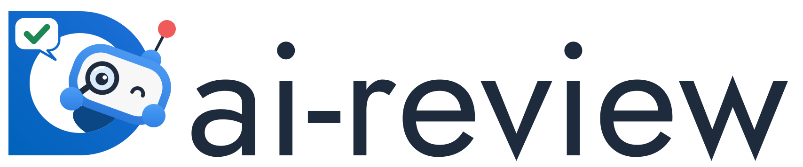
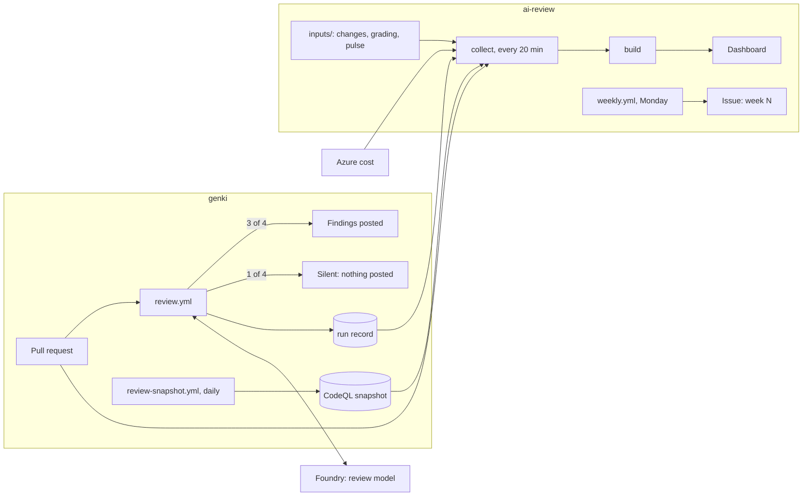

<div align="center">

<picture>
  <source media="(prefers-color-scheme: dark)" srcset="docs/images/ai-review-dark.svg">
  
</picture>

[](#status)
[](https://github.com/digdir/ai-review/actions/workflows/dashboard.yml?query=branch%3Amain)
[](LICENSE)
<br>
[](.github/workflows/dashboard.yml)
[](https://svelte.dev)
[](https://designsystemet.no)

[Dashboard](https://salmon-field-00cefca03.4.azurestaticapps.net) · [Working with the review](docs/working-with-the-review.md) · [The experiment](docs/experiment.md) · [Runbook](docs/runbook.md) · [Joining](docs/joining.md)

</div>

> [!NOTE]
> **A six-week experiment, not a finished service.** The review runs on every pull request in [digdir/genki](https://github.com/digdir/genki) from 2026-11-09, and the decision to keep, adjust or stop it is made in the week of 2026-12-21. See [Status](#status).

ai-review is AI code review for Digdir repositories, and the dashboard that shows whether it is worth it. A model reviews each pull request against rules the repository writes itself, in `REVIEW.md` and `AGENTS.md`. It comments; people decide and merge.

It provides:

- **A review on every pull request**: one summary and one review with all findings at once, marked Important, Nit or Pre-existing, each with the line it rests on
- **A follow-up after each push** that checks the open findings against the new code and resolves the fixed ones, without adding new findings
- **No stored keys**: the review calls the lab's own Azure AI Foundry with a federated identity, and only comments; it cannot approve, push or merge
- **A record of every run**: cost, duration, model and findings, with no names, so the review can be measured instead of judged by feel
- **A dashboard** with findings, fix rates, noise, time to merge, rework and cost per repository, measured against the criteria the experiment was approved on
- **A control group**: one pull request in four is reviewed silently, so the effect on the team can be compared with pull requests that got no comments

## Quickstart

You need Node 24, the [GitHub CLI](https://cli.github.com) and, for cost, the [Azure CLI](https://learn.microsoft.com/cli/azure/).

```sh
git clone https://github.com/digdir/ai-review.git && cd ai-review
npm ci
gh auth login && az login
npm run collect   # read the repositories into data/
npm run dev       # the dashboard with hot reload
```

Without logins, open the dashboard and pick a moment under **Sample data** in the top bar (week 1, week 5 or after the experiment) to see it with sample data in the real shape.

## Documentation map

| You want to                                 | Read                                                                                                                                          |
| ------------------------------------------- | --------------------------------------------------------------------------------------------------------------------------------------------- |
| Open pull requests in genki                 | [Working with the review](docs/working-with-the-review.md): what you get, how to answer findings, `review again`, the silent group, `escaped` |
| Run the review or the experiment            | [Runbook](docs/runbook.md): the Monday routine, failures, the budget, everything that is set up                                               |
| Grade findings                              | [Grading](docs/grading.md)                                                                                                                    |
| Know what is measured and how it is decided | [The experiment](docs/experiment.md)                                                                                                          |
| Get the review in your repository           | [Joining](docs/joining.md), and [where this is going](docs/platform.md)                                                                       |
| Change the dashboard                        | [How it works](#how-it-works), and [AGENTS.md](AGENTS.md)                                                                                     |

## Repository layout

```text
repos/<owner>/<name>.json     settings per repository
inputs/<owner>/<name>/        hand-entered data: changes, grading, pulse
dashboard/                    collector, change log, grading and weekly issue (plain Node)
src/                          the dashboard (Svelte 5 and TypeScript)
  lib/compute.ts              every metric and criterion
  screens/                    Overview, Repository, Findings and Operations
  views/                      Repositories, Start here and one repository
docs/                         the documentation above
.github/workflows/            dashboard.yml (every 20 min by day, hourly otherwise), weekly.yml (Mondays)
```

## How it works



1. **Review.** `review.yml` in the repository runs when a pull request opens. One in four is in the silent group: reviewed and recorded, but nothing is posted. After each push a cheaper model checks the open findings and resolves the fixed ones.
2. **Record.** Every run uploads a run record. A daily `review-snapshot` workflow records the CodeQL alerts, which this repository cannot read with its own token.
3. **Collect.** Every twenty minutes on weekdays and every hour otherwise, `dashboard/collect.mjs` reads pull requests, threads, run records, CI, the snapshot and Azure cost for each repository in `repos/`, plus the hand-entered inputs. Changes to the review setup are found in merged pull requests and joined with the change log. A repository that fails is marked on the overview and does not stop the others. It stores no logins, only a hash of each pull request author's login for the username filter.
4. **Build.** Vite builds the dashboard with the data bundled in, and the workflow deploys the static site to Azure Static Web Apps. Only accounts in the lab's tenant can open it.
5. **Routine.** Each Monday `weekly.yml` opens an issue with last week's numbers and the checklist from the [runbook](docs/runbook.md#every-monday).
6. **Decide.** After week 6 the criteria in [the protocol](docs/experiment.md) decide: keep, adjust or stop.

### Settings per repository

```json
{
  "repo": "digdir/genki",
  "baselineFrom": "2026-10-19",
  "start": "2026-11-09",
  "workflows": { "review": "review.yml", "ci": "ci.yml" },
  "azure": { "subscription": "…", "resourceGroup": "…" },
  "experiment": { "weeks": 6, "budgetNok": 7500, "minCell": 5 }
}
```

`azure` is optional; without it, cost is taken from the run records. A repository without `experiment` gets the plain numbers without groups and criteria. The repository must be public, since the workflow reads it with its own token.

## Working on it

```sh
npm run check            # svelte-check and the tests; the workflow runs it before each deploy
npm run build            # the static site in dist/
npm run preview          # serve dist/
npm run grading-sample -- --repo digdir/genki --week 3
npm run grading-merge -- --repo digdir/genki --week 3 --graders a.json b.json
npm run weekly -- --dry-run   # print the Monday issue without opening it
```

Opening `dist/index.html` straight from disk does not work, since browsers block module scripts on `file://`. The rules for code in this repository, including Svelte 5 runes and the privacy rule, are in [AGENTS.md](AGENTS.md).

### Setup

Done once, by someone with rights in the digdir organisation and the Azure subscription. What exists today is listed in the [runbook](docs/runbook.md#what-is-set-up).

- **Static Web App** on the Standard plan, which custom login needs. Its name and resource group are the variables `SWA_NAME` and `SWA_RESOURCE_GROUP`.
- **App registration for login**, single tenant, with redirect URI `https://<host>/.auth/login/aad/callback` for each host and admin consent for `openid`, `profile` and `offline_access`. `AAD_CLIENT_ID` and `AAD_CLIENT_SECRET` are app settings on the Static Web App. The secret lasts a year.
- **Workflow identity** with a federated credential for the `production` environment of `digdir/ai-review` (subject `repo:digdir@<owner id>/ai-review@<repo id>:environment:production`), Contributor on the Static Web App and Cost Management Reader on the review's resource group. `AZURE_CLIENT_ID`, `AZURE_TENANT_ID` and `AZURE_SUBSCRIPTION_ID` are variables in that environment.
- **Custom domain**: a DNS zone delegated from the parent zone, with an alias record to the Static Web App and its validation TXT record.

No deployment token is stored: the workflow fetches it with its Azure login on each run.

## Status

| Area                   | Where it stands                                                                                                                                                                 |
| ---------------------- | ------------------------------------------------------------------------------------------------------------------------------------------------------------------------------- |
| **Review in genki**    | Running on every pull request since 2026-11-09, with a silent group of 25 percent.                                                                                              |
| **Experiment**         | Weeks 1 and 2 are setup. The decision rests on weeks 3 to 6, 2026-11-23 to 2026-12-20.                                                                                          |
| **Dashboard**          | Deployed and rebuilt every twenty minutes on weekdays, hourly otherwise. Sign-in waits for admin consent on the app registration, and the custom domain for its DNS delegation. |
| **Other repositories** | Can join the dashboard now. The review moves here as a reusable workflow only after the week-6 decision, so the setup being measured does not change halfway.                   |

---

## Contributing

Contributions are welcome.

1. Read [AGENTS.md](AGENTS.md) for the layout and the rules.
2. Run `npm run check` before you open a pull request.
3. Report vulnerabilities privately as described in [Digdir's security policy](https://github.com/digdir/.github/blob/main/SECURITY.md), never in a public issue.

Everyone taking part follows the [Code of Conduct](https://github.com/digdir/.github/blob/main/CODE_OF_CONDUCT.md). ai-review is released under the [MIT licence](LICENSE).
