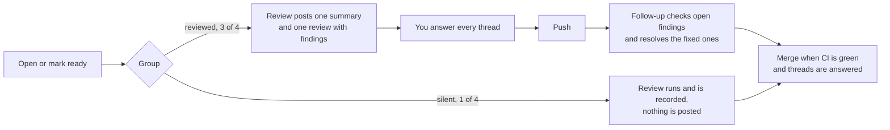

# Working with the review

For everyone who opens pull requests in a repository that has the AI review. genki is the first. The review comments; it never approves, blocks or merges. People decide.

## What happens to your pull request

1. **When it opens.** The review starts when a pull request opens or leaves draft. Drafts, Renovate and pull requests from forks are not reviewed.
2. **Which group.** The pull request number puts one in four in a silent group. The review runs and is recorded the same way, but posts nothing. This is the experiment's control group. If you get no comments, that is why, not a fault.
3. **What you get** in the reviewed group:
   - **One summary comment** at the top: what the change does, every finding with its status, and a prompt you can give your coding agent to fix the open ones.
   - **One review** with all findings at once, each marked **Important**, **Nit** or **Pre-existing**. Most come with a suggestion you can commit from the pull request.
4. **After each push**, a cheaper model checks the open findings against the new code. Fixed ones get a reply naming the commit and are resolved, and the summary is updated. A push never brings new findings.

## Answering findings

Every thread gets an answer before you merge. A reply is enough; no second person is needed.

| The finding is              | Do this                                                                                                      |
| --------------------------- | ------------------------------------------------------------------------------------------------------------ |
| Right, and worth it         | Fix it and push. The follow-up resolves the thread.                                                          |
| Right, but not worth it now | Reply "not fixing, because ..." and resolve it. Open an issue if it should be done later.                    |
| Wrong                       | Reply "not fixing, because ..." with the reason, and resolve it. If a rule is missing or unclear, see below. |
| Unclear                     | Ask in the thread, or treat it as wrong and say why.                                                         |

Write the reason as a sentence a colleague would understand. These replies are how the experiment counts fixed and dismissed findings, so "fixed" without a fix or a silent resolve skews the numbers.

**Severities.**

- **Important**: the change breaks something the repository's `REVIEW.md` lists as Important, such as tenant isolation, the model gate, personal data or a public contract.
- **Nit**: worth knowing, never a blocker. At most three per review.
- **Pre-existing**: an Important problem in lines the pull request did not touch. At most two.

## Asking for another review

Add the label **`review again`** to run the full review once more, for example after a large rework. The label is taken off again when the run ends. Use it sparingly: each run costs money, and at most three rounds per pull request is the rule.

On a pull request in the silent group, do not add the label just to get comments. It moves the pull request out of the control group in practice, even though it is still counted in it.

## Review before you open

Run the same review locally so the one in CI finds nothing: `/review-change` in Claude Code, or ask another coding agent to follow `.claude/skills/review-change/SKILL.md`. This is allowed in both groups.

## When the review is wrong

Do not argue with the model in the thread. Fix the rule:

- A finding that should never be reported, or one that missed something it should have seen: change `REVIEW.md` in its own pull request.
- A mistake agents keep making: add it to `AGENTS.md`, with a test if a test can hold it.

Rule changes are logged on the dashboard automatically, so the experiment can see what each one did.

## When something slips through

If a merged change turns out to have a bug the review had a chance to see, add the label **`escaped`** to the pull request that fixes it. The dashboard counts these as problems the review missed.

## Risk and undo

The pull request template asks for **Risk** (low, or sensitive because of what it touches: auth, tenancy, the model gate, personal data, migrations, infra, workflows) and **Undo** (revert is enough, or the data or infra step it needs). Fill both in. The review checks sensitive paths against `.github/review-security.md`.

## Where to see the numbers

The dashboard (sign in with your lab account) shows findings, fix rates, noise, time to merge and cost per repository. The [experiment protocol](experiment.md) says what is measured and how the decision is made.
